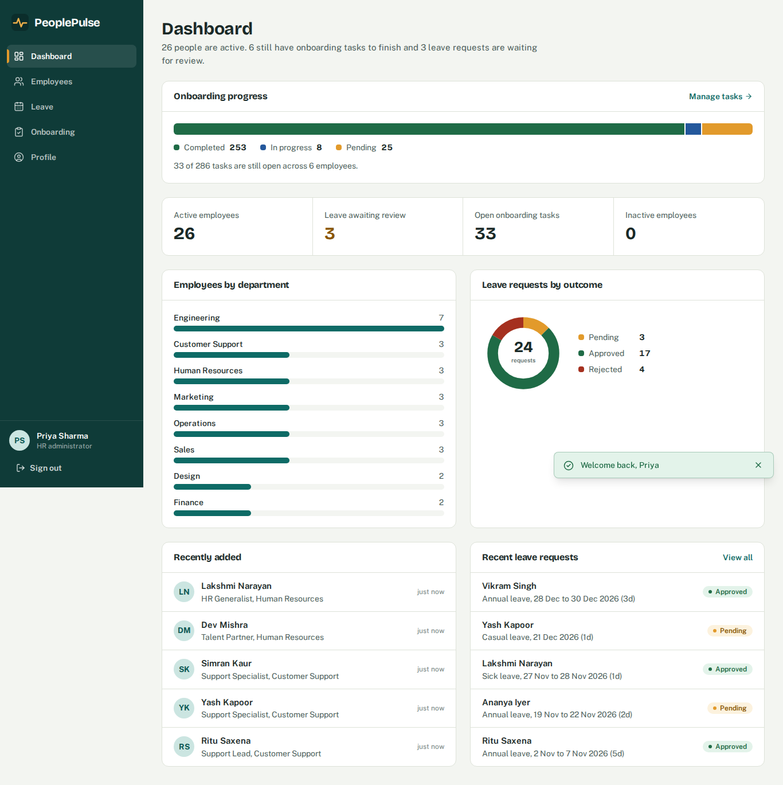
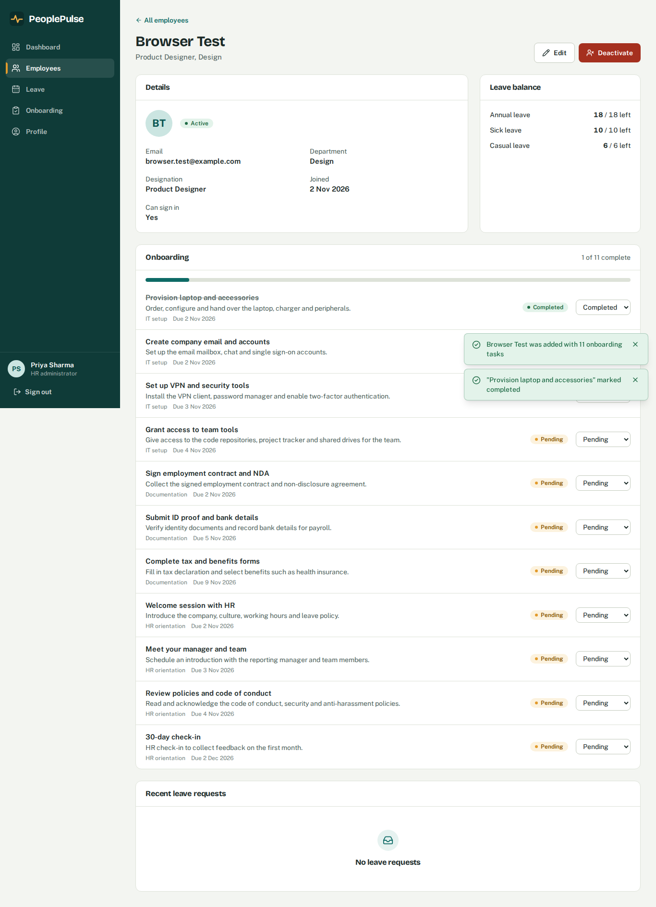
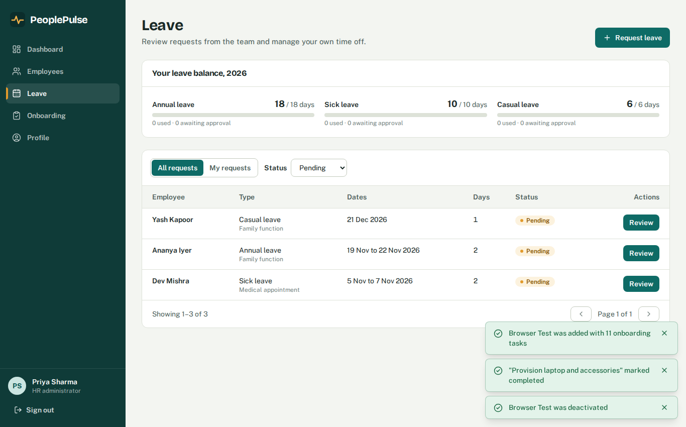
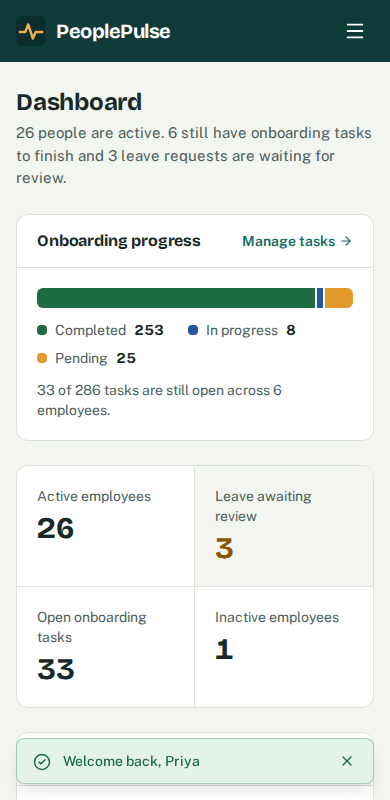

# PeoplePulse

A full-stack HR management platform: employee records, leave management, **automated employee onboarding** and a live analytics dashboard.

Built as a portfolio project for an SDE Intern (Full Stack) role in a People Tech & Analytics team. It demonstrates Python backend engineering, REST API design, relational database design with migrations, role-based access control, automated testing and a modern React frontend.

> **Status:** runs locally and passes its automated tests (see [Testing](#testing)). It has **not been deployed**; the Render and Vercel configuration is included and the steps are in [Deployment](#deployment).

| Dashboard | Employee details (auto-generated onboarding) |
|---|---|
|  |  |
| **Leave approvals (HR)** | **Mobile** |
|  |  |

More in [`screenshots/`](screenshots): login, employee directory, add-employee form, onboarding, profile, employee dashboard, request-leave dialog.

## Features

- **Authentication & roles**: login, logout (the token is revoked server-side), bcrypt password hashing, JWT, `hr_admin` and `employee` roles enforced on the backend, password change.
- **Employees**: add, view, edit, deactivate/reactivate. Search, department/status filters, pagination. Duplicate emails are rejected (case-insensitive).
- **Leave**: submit requests, working-day calculation (Mon-Fri), overlap prevention, yearly balances, approve/reject with a note, cancel. HR cannot approve their own request.
- **Automated onboarding** *(the core feature)*: creating an employee generates 11 tasks across *IT setup*, *Documentation* and *HR orientation* with due dates relative to the joining date. Creation of the employee, optional login and all tasks happens in **one database transaction**: if any step fails nothing is saved. Tasks move through pending → in progress → completed; progress is shown per employee and on the dashboard.
- **Analytics dashboard**: active headcount, department distribution, leave counts by status, onboarding completed vs pending, recent hires and leave requests. Every number comes from a SQL query.
- **UI**: responsive sidebar layout, toasts, loading / empty / error states, confirmation dialogs, labelled forms, keyboard-accessible dialogs, skip link.

## Architecture

```
React (Vite, Tailwind) ──HTTPS/JSON + JWT──▶ FastAPI ──SQLAlchemy──▶ PostgreSQL
                                              │
   api/      thin routes: parse request, check role, call a service, return schema
   services/ business rules (leave overlap, balances, onboarding automation, analytics)
   models/   SQLAlchemy tables with constraints and indexes
   schemas/  Pydantic request/response validation
   core/     settings (env vars), security (bcrypt/JWT), shared errors
```

Key design decisions (good interview talking points):

- **Routes → services → models.** Routes never contain business rules, so rules are testable without HTTP.
- **Transactions.** `services/employees.create_employee` flushes to get the id, adds the user and tasks, then commits once; any exception triggers a rollback. A test simulates a failure mid-way and asserts nothing was saved.
- **Concurrency.** Leave creation locks the employee row (`SELECT … FOR UPDATE`) so two simultaneous requests can't both pass the overlap/balance check. Duplicate-email races are caught from the unique-index `IntegrityError`.
- **Database-level safety.** `CHECK` constraints (valid statuses, `end_date >= start_date`), unique constraints (email, task per employee) and indexes on the columns the app filters by.
- **Leave balances are computed, not stored**, from approved + pending requests, so they can never drift out of sync.
- **Consistent errors.** Every failure is `{"detail": "message"}`; validation errors add `errors: [{field, message}]` so forms can show messages beside inputs.
- **Real logout.** JWTs carry an id (`jti`); logout stores it in `revoked_tokens` and every request checks it. Deactivating an employee also stops their existing token working.

### Database

`users` · `employees` · `leave_requests` · `onboarding_tasks` · `revoked_tokens`, created by Alembic migration `backend/alembic/versions/`.

## Tech stack

React 19, Vite, Tailwind CSS 4, React Router, lucide-react (icons), self-hosted fonts · Python 3.12, FastAPI, Pydantic v2, SQLAlchemy 2, Alembic, PyJWT, bcrypt · PostgreSQL 16 · Pytest + FastAPI TestClient.

## Local setup (Ubuntu)

Prerequisites: Python 3.10+, Node.js 20+, Git, PostgreSQL.

```bash
sudo apt update
sudo apt install -y python3-venv python3-pip postgresql git
# Node 20+: https://nodejs.org or `nvm install --lts`
```

### 1. PostgreSQL

```bash
sudo systemctl start postgresql
sudo -u postgres psql <<'SQL'
CREATE USER peoplepulse WITH PASSWORD 'choose-a-password' CREATEDB;
CREATE DATABASE peoplepulse OWNER peoplepulse;
CREATE DATABASE peoplepulse_test OWNER peoplepulse;   -- used only by pytest
SQL
```

### 2. Backend

```bash
cd backend
python3 -m venv .venv && source .venv/bin/activate
pip install -r requirements-dev.txt
cp .env.example .env            # then edit .env (see table below)
python -c "import secrets; print(secrets.token_urlsafe(48))"   # paste as SECRET_KEY
alembic upgrade head            # create the tables
python -m scripts.seed          # development demo data (see below)
uvicorn app.main:app --reload   # http://localhost:8000  (Swagger UI at /docs)
```

### 3. Frontend

```bash
cd frontend
npm install
npm run dev                     # http://localhost:5173
```

The frontend talks to `http://localhost:8000` by default; override with `VITE_API_URL` (see `frontend/.env.example`).

### Environment variables (`backend/.env`)

| Variable | Purpose |
|---|---|
| `DATABASE_URL` | PostgreSQL URL, e.g. `postgresql://peoplepulse:pw@localhost:5432/peoplepulse` |
| `SECRET_KEY` | JWT signing key. Required. In production it must be 32+ random characters or the app refuses to start |
| `ENVIRONMENT` | `development` or `production`. `production` blocks the seed script |
| `ACCESS_TOKEN_EXPIRE_MINUTES` | Token lifetime (default 60) |
| `CORS_ORIGINS` | Comma-separated frontend origins allowed to call the API |
| `TEST_DATABASE_URL` | Database used by pytest. **Its name must end in `_test`**; tests wipe it and refuse to run otherwise |

`.env` is git-ignored. Only `.env.example` (with placeholders) is committed.

## Demo data and credentials (development only)

`python -m scripts.seed` creates 26 fictional people (`@example.com` addresses), ~24 leave requests and their onboarding tasks. Re-run with `--reset` to wipe and regenerate (it asks you to type the database name).

| Role | Email | Password |
|---|---|---|
| HR administrator | `hr.admin@example.com` | `HrAdmin#2026` |
| Employee | `demo.employee@example.com` | `Employee#2026` |

These accounts **exist only if you run the seed script**, which refuses to run when `ENVIRONMENT=production`. The login page's "fill demo account" buttons are compiled out of production builds. **Never reuse these passwords anywhere real.**

For a real deployment create the first administrator with a hidden password prompt:

```bash
python -m scripts.create_admin --email you@company.com --name "Your Name"
```

## Testing

```bash
cd backend && source .venv/bin/activate
pytest -q
```

83 tests covering authentication (success, failure, expired/forged tokens, logout, role checks), employee CRUD and validation, duplicate emails, search/filter/pagination, leave creation, overlap and balance rules, approval/rejection, onboarding automation (including the rollback test), task status updates, permissions and dashboard statistics.

Tests run against the separate `peoplepulse_test` database and build its schema by running the real Alembic migrations (so migrations are tested too). I also did mutation checks: deliberately breaking the overlap check and the HR-only guard, and confirmed the tests fail.

The frontend was verified with a scripted Chromium run (Playwright) covering login, the employee workflow, onboarding updates, leave request/approval, role restrictions, dialogs and mobile layout. That script is not part of the repository.

## API

Interactive docs: **http://localhost:8000/docs** (click *Authorize*, use the HR demo email as `username`).

| Area | Endpoints |
|---|---|
| Auth | `POST /api/auth/login` · `POST /api/auth/logout` · `GET /api/auth/me` · `PUT /api/auth/me/password` |
| Employees (HR) | `GET/POST /api/employees` · `GET/PUT /api/employees/{id}` · `POST …/{id}/deactivate` · `POST …/{id}/activate` · `GET /api/employees/departments` |
| Leave | `POST/GET /api/leaves` · `GET /api/leaves/balance` · `PATCH /api/leaves/{id}/review` (HR) · `POST /api/leaves/{id}/cancel` |
| Onboarding | `GET /api/onboarding/tasks` · `PATCH /api/onboarding/tasks/{id}` · `GET /api/onboarding/progress` |
| Analytics (HR) | `GET /api/analytics/dashboard` |
| Health | `GET /health` |

Example requests:

```bash
# Log in (form-encoded; the email goes in `username`)
TOKEN=$(curl -s -X POST localhost:8000/api/auth/login \
  -d 'username=hr.admin@example.com&password=HrAdmin#2026' | python3 -c 'import sys,json;print(json.load(sys.stdin)["access_token"])')

# Create an employee: onboarding tasks are generated automatically
curl -s -X POST localhost:8000/api/employees -H "Authorization: Bearer $TOKEN" \
  -H 'Content-Type: application/json' \
  -d '{"full_name":"Asha Verma","email":"asha@example.com","department":"Engineering",
       "designation":"Software Engineer","joining_date":"2026-11-02"}'

# Search employees
curl -s "localhost:8000/api/employees?q=asha&department=Engineering&page=1&page_size=10" \
  -H "Authorization: Bearer $TOKEN"

# Approve a leave request
curl -s -X PATCH localhost:8000/api/leaves/1/review -H "Authorization: Bearer $TOKEN" \
  -H 'Content-Type: application/json' -d '{"decision":"approved","note":"Enjoy"}'
```

## Deployment

Configuration is prepared but **I have not deployed it**. Steps:

**Backend + database on Render**
1. Push this repository to GitHub.
2. In Render choose *New → Blueprint* and select the repo. It reads `render.yaml`, creates a PostgreSQL database and the web service, generates `SECRET_KEY`, and runs `alembic upgrade head` on every deploy.
3. Set `CORS_ORIGINS` to your Vercel URL once you have it.
4. Open the service *Shell* and run `python -m scripts.create_admin --email … --name …`.
5. Check `https://<service>.onrender.com/health` returns `{"status":"ok"}`.

**Frontend on Vercel**
1. Import the repo, set *Root Directory* to `frontend`.
2. Add environment variable `VITE_API_URL=https://<service>.onrender.com`.
3. Deploy. `vercel.json` rewrites all routes to `index.html` so page refreshes work.

Render's free tier sleeps after inactivity (first request is slow) and free databases expire after a limited period; check Render's current terms.

## Known limitations

- Public holidays are not modelled: leave days count Monday-Friday only.
- The JWT is kept in `localStorage`, which is simple but readable by any XSS. A production system might use httpOnly cookies.
- No login rate limiting, email notifications, or password reset by email (HR sets temporary passwords).
- Leave requests cannot span two calendar years (submit one per year). Allowances are fixed constants in `core/constants.py`, not configurable per employee.
- The onboarding task list is the same for every employee (a template in `services/onboarding.py`); the HR page loads all tasks for the chosen filters and filters status in the browser, which is fine at this scale but not for thousands of staff.
- Revoked-token cleanup runs opportunistically on logout rather than as a scheduled job.
- Starlette prints a deprecation warning about `httpx` when running tests; it is harmless.
- Frontend has no automated unit tests; it was checked with a scripted browser run.

## Project structure

```
peoplepulse/
├── backend/
│   ├── app/ {api, core, models, schemas, services, database.py, main.py}
│   ├── alembic/            migrations
│   ├── scripts/            seed.py (dev only), create_admin.py
│   ├── tests/
│   ├── requirements.txt, requirements-dev.txt, .env.example
├── frontend/src/ {components, pages, services, context, hooks, lib}
├── screenshots/
├── render.yaml
└── README.md
```
